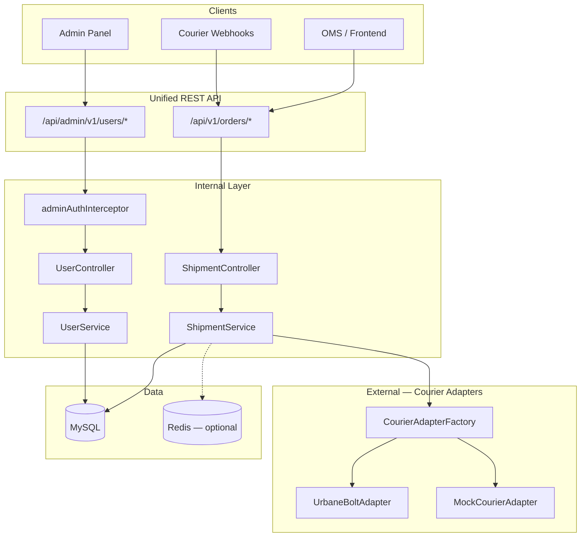
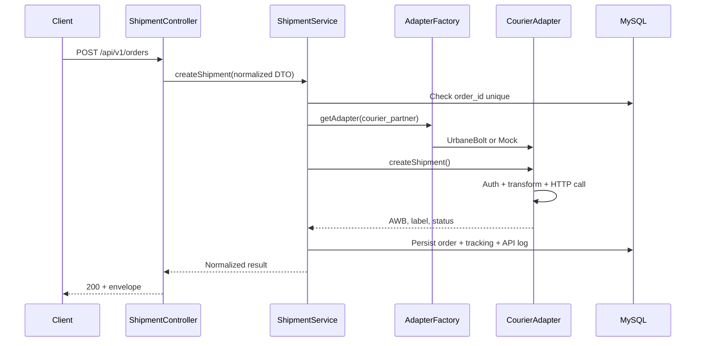
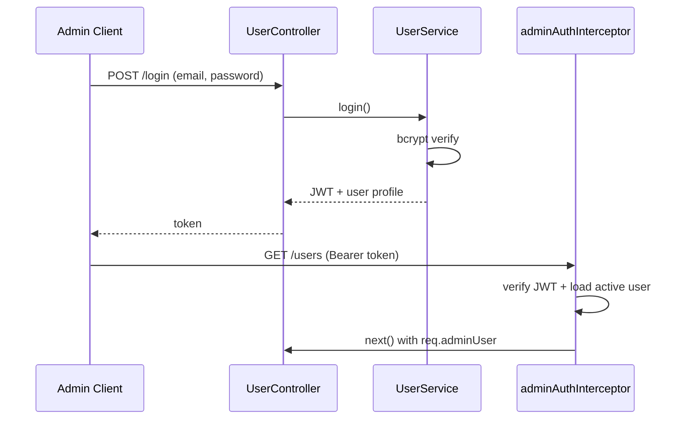

# Design Document — Multi-Courier Integration Platform

## 1. Purpose

Build a **single unified logistics API** so e-commerce / OMS systems can create, track, and cancel shipments without knowing each courier's internal API format. Courier-specific logic lives in **pluggable adapters** behind a stable contract.

Secondary scope: **admin user management** with JWT authentication for internal operations.

---

## 2. High-Level Architecture



---

## 3. Design Patterns

### 3.1 Strategy + Factory (Couriers)

| Pattern | Role |
|---------|------|
| **Strategy** (`CourierAdapter`) | Each courier implements `createShipment`, `trackShipment`, `cancelShipment` |
| **Factory** (`CourierAdapterFactory`) | Resolves adapter by `courier_partner` string at runtime |
| **Adapter** | Transforms normalized DTOs ↔ partner payloads (e.g. UrbaneBolt manifest array) |

**Why:** Shipment service depends on the interface, not UrbaneBolt/Mock details (**Dependency Inversion**). Adding Shiprocket = new adapter class + config — no changes to routes or unified DTOs (**Open/Closed**).

### 3.2 Layered modules

```
Router → Controller → Service → Repository → Prisma/MySQL
                ↓
         CourierAdapter (external)
```

- **Controller:** HTTP, response envelope, error mapping
- **Service:** Business rules, idempotency, bulk orchestration, adapter calls
- **Repository:** DB access (read/write split for primary/replica)

### 3.3 Manual dependency injection

`App` + `AppContext` wire dependencies at startup — no framework container. Keeps the assignment codebase explicit and testable.

---

## 4. Request Flows

### 4.1 Create shipment



Steps:

1. Zod validation (`validateRequestInterceptor`)
2. Idempotency check on `order_id` (unique DB constraint)
3. Adapter selected by `courier_partner`
4. Outbound call with retry on auth failure (UrbaneBolt)
5. Persist `shipment_orders`, initial `shipment_tracking_history`, `courier_api_logs`
6. Return normalized response (never raw courier errors to client)

### 4.2 Bulk create

1. `POST /api/v1/orders/bulk` → validate max 100 orders
2. Insert `bulk_batches` row → **202 Accepted** + `batch_id`
3. Background: process in chunks of `bulk.concurrency` via `Promise.all`
4. Client polls `GET /api/v1/orders/bulk/:batch_id`
5. Partial failures stored in `results` JSON

**Trade-off:** In-process async is fine for assignment scale; production would use SQS/BullMQ.

### 4.3 Admin authentication



- JWT payload: `{ userId, email }`
- Protected routes use `adminAuthInterceptor` before controller
- Login route is public

---

## 5. Database Schema

Single Prisma schema: `prisma/schema.prisma`  
Single init migration: `prisma/migrations/20260601000000_init/`

| Table | Purpose |
|-------|---------|
| `users` | Admin accounts (bcrypt password, soft delete) |
| `courier_partners` | Registry: `mock`, `urbanebolt` |
| `shipment_orders` | Core shipment: order_id, AWB, status, full req/res JSON |
| `shipment_tracking_history` | Append-only tracking events |
| `bulk_batches` | Bulk job status + per-order results |
| `courier_api_logs` | Audit trail for every outbound courier call |
| `webhook_events` | Inbound webhook storage |

### Shipment status lifecycle

```
CREATED → PICKED_UP → IN_TRANSIT → OUT_FOR_DELIVERY → DELIVERED
```

Terminal: `CANCELLED`, `FAILED`, `RTO`

UrbaneBolt codes (`MAN`, `PKD`, `DLV`, etc.) mapped in `external/urbanebolt/transformers`.

### Seed data (migration)

- **Admin:** `admin@example.com` / `Admin@12345`
- **Couriers:** `mock`, `urbanebolt`

---

## 6. Unified API Contract

Clients send **normalized JSON** with `courier_partner`. They never send UrbaneBolt field names (`consName`, `rtnPincode`, etc.).

Example normalized create body:

```json
{
  "order_id": "ORD-001",
  "courier_partner": "mock",
  "shipper": { "name", "mobile", "address", "city", "state", "country", "pincode" },
  "consignee": { ... },
  "return_address": { ... },
  "package": { "weight", "length", "breadth", "height", "pieces", "description" },
  "payment": { "mode", "collectable_value", "declared_value" }
}
```

Adapter transforms this to partner format (e.g. UrbaneBolt manifest **array**).

---

## 7. UrbaneBolt Integration

| Operation | Method | UrbaneBolt endpoint |
|-----------|--------|---------------------|
| Auth | POST | `/api/v1/auth/getToken/` |
| Create | POST | `/api/v1/services/manifest/` (body: JSON array) |
| Track | GET | `/api/v1/services/tracking-pub/?awb=` |
| Cancel | POST | `/api/v1/services/cancel/` |

Implementation: `src/external/urbanebolt/`

- Token cached in-memory with expiry refresh
- Optional `csrfToken` / `sessionId` cookies in config
- Retry once on 401/403 after token refresh
- HTTP client retries on 5xx with exponential backoff

---

## 8. Error Handling

| Layer | HTTP | Code |
|-------|------|------|
| Validation (Zod) | 400 | `VALIDATION_ERROR` |
| Unknown courier | 400 | `UNKNOWN_COURIER` |
| Duplicate order_id | 409 | `ORDER_ALREADY_EXISTS` |
| Courier 4xx | 502 | `COURIER_CLIENT_ERROR` |
| Courier timeout | 504 | `COURIER_TIMEOUT` |
| Courier auth fail | 502 | `COURIER_AUTH_ERROR` |
| Admin unauthorized | 401 | `UNAUTHORIZED` |
| Invalid login | 401 | `INVALID_CREDENTIALS` |

All courier failures logged with: `order_id`, `courier_partner`, `request_id`, error code.

Raw courier error messages are **not** exposed to API consumers.

---

## 9. Configuration

All runtime config in `config/config.yaml` (Zod-validated at startup):

- MySQL primary + replica
- Redis (optional via `cache.enabled`)
- JWT auth settings
- Per-courier credentials, timeouts, retries
- Bulk limits

Prisma uses `DATABASE_URL` from `.env` for migrations only.

---

## 10. Optional Redis Cache

`CacheProvider` abstraction:

- `RedisCacheProvider` when `cache.enabled: true`
- `NoOpCacheProvider` by default — **no Redis required**

Shipment flow does not depend on cache.

---

## 11. Adding a New Courier (Checklist)

1. `src/external/<name>/service/<name>-adapter.ts` → implement `CourierAdapter`
2. `src/external/<name>/transformers/` → map normalized ↔ partner API
3. Config block in `config/config.yaml` + Zod in `src/config/schema.ts`
4. Register in `AppContext.buildCourierAdapters()`
5. Seed row in `courier_partners` (migration or startup seed)

**Zero changes** to: shipment routes, controllers, unified DTOs, shipment service.

---

## 12. Trade-offs & Production Roadmap

| Area | Current (assignment) | Production upgrade |
|------|---------------------|-------------------|
| Bulk jobs | In-process `setImmediate` | SQS / BullMQ |
| UrbaneBolt token | In-memory per instance | Shared Redis cache |
| Webhooks | Generic storage | Per-courier parsers |
| Auth | JWT for admin only | API keys / OAuth for OMS |
| Observability | Pino structured logs | OpenTelemetry |
| Rate limiting | None | API gateway |

---

## 13. Project Layout

```
src/
├── bootstrap/           App + AppContext (DI)
├── internal/
│   ├── shipment/        Unified logistics API
│   ├── user/            Admin users
│   └── shared/
│       ├── interceptors/
│       │   ├── req-validator/
│       │   └── admin-auth/
│       └── headers/
├── external/
│   ├── courier/         Interface + factory
│   ├── urbanebolt/
│   └── mock-courier/
├── pkg/                 Shared infrastructure
├── router/
└── server/
```

---

## 14. Assumptions

- Single MySQL database; replica falls back to primary in local dev
- `order_id` is client-supplied and globally unique (idempotency)
- Bulk scale ≤ 100 orders per request
- UrbaneBolt UAT credentials provided in assignment Postman collection
- Shipment APIs are public; admin APIs require JWT
